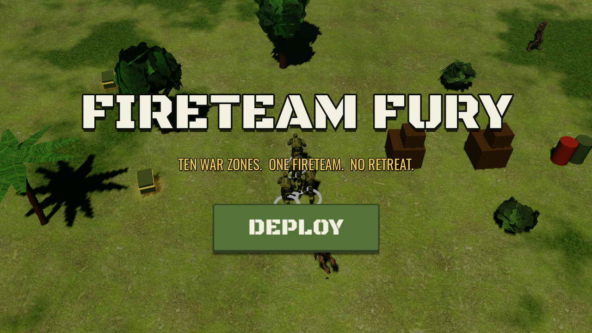
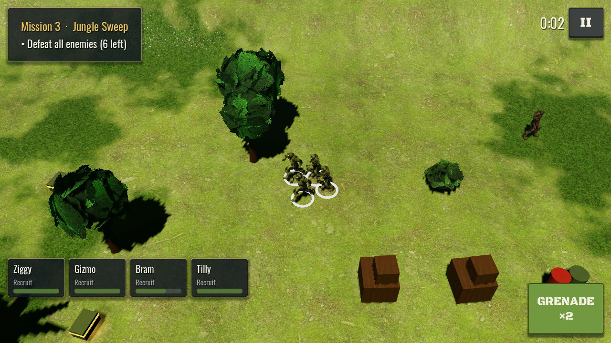
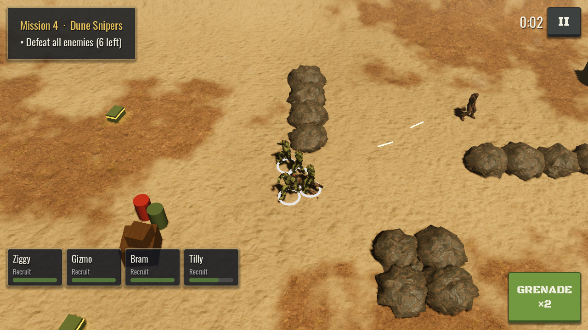
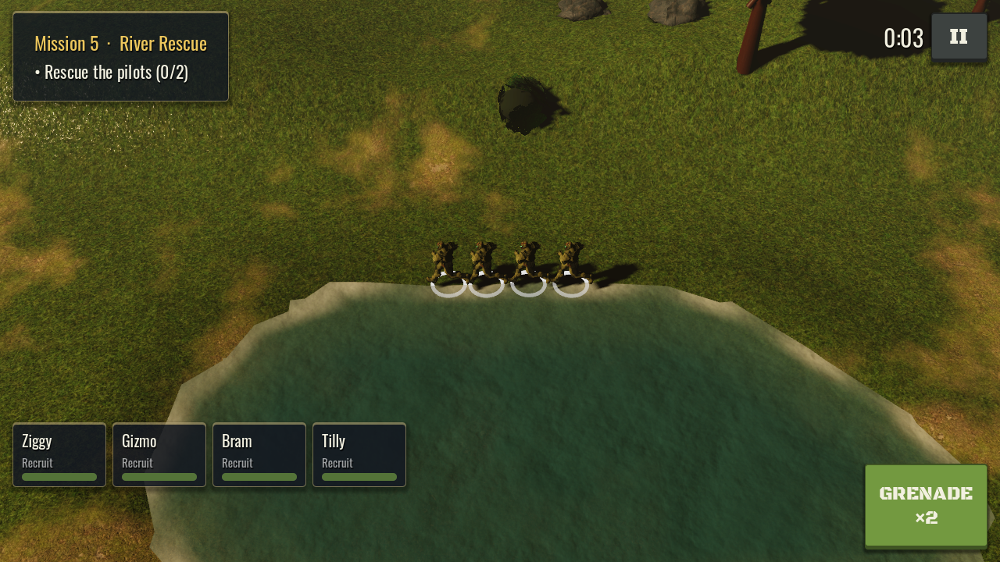
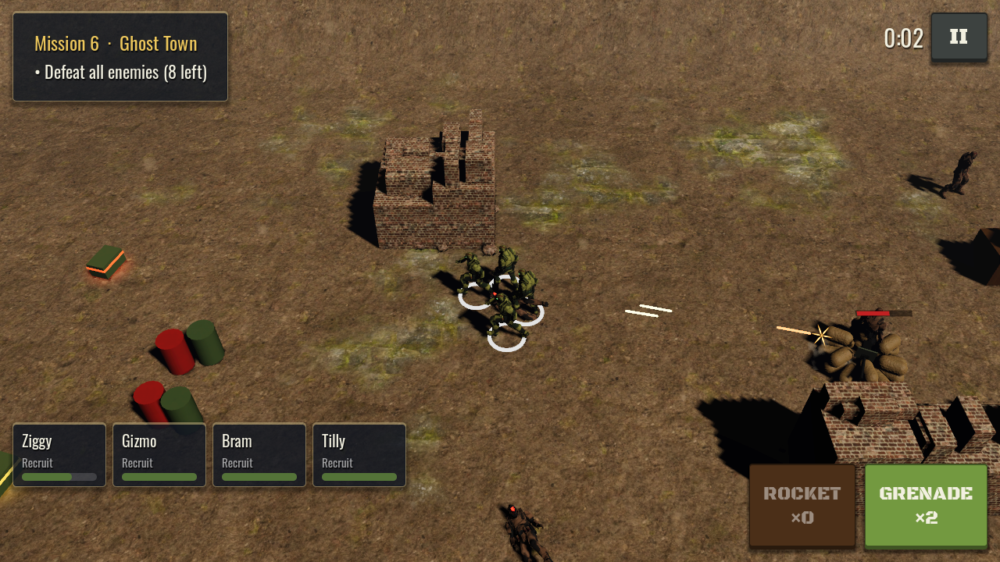
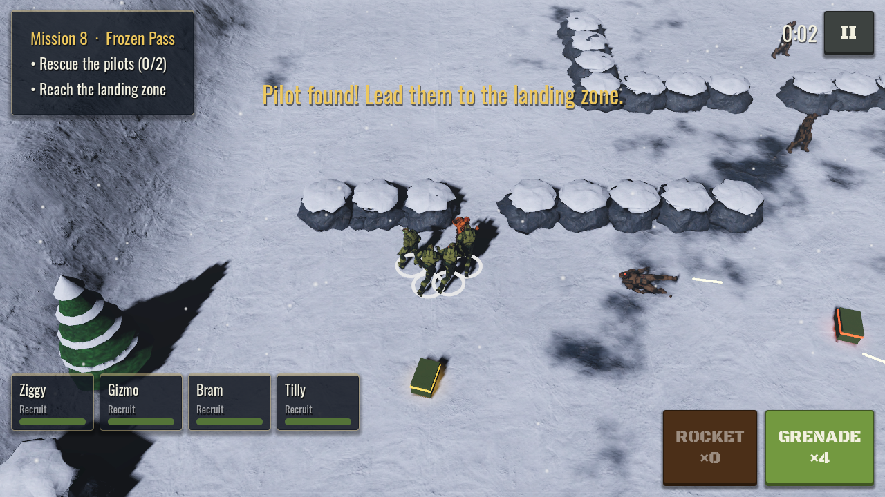
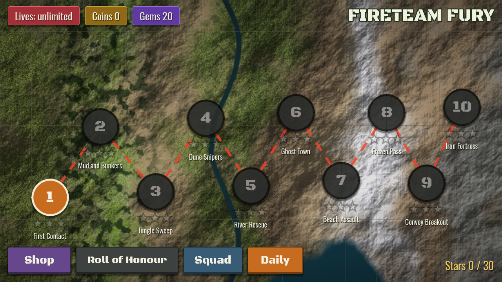

# Fireteam Fury

A top-down squad action game for Android. You lead a small fireteam through ten war zones: grassland, forest, jungle, desert, river, a ruined town, a beach landing, a frozen pass, a desert convoy route and a final enemy base.

Built with **Godot 4.3** on the Mobile (Vulkan) renderer, with automatic fallback to OpenGL on phones without Vulkan. The look comes from photo-scanned ground textures, HDR sky lighting, real-time shadows, glow, fog, GPU particle smoke and fire, and an animated, rigged soldier.



| | |
|---|---|
|  |  |
|  |  |
|  |  |



## How to play

- **Tap the ground** and your squad moves there in formation.
- **Tap an enemy** to focus fire on it. Soldiers also fire at anything in range on their own.
- **Grenade / Rocket buttons:** tap the button, then tap the target. Bunkers only fall to explosives.
- **Tanks:** tap the tank to climb in, tap enemies to fire shells, then press EXIT TANK to get out.
- **Drag** to look around, **pinch** to zoom.
- Rescue downed pilots by walking next to them and leading them to the landing zone.

## The 10 missions

| # | Mission | Setting | Objective | New idea |
|---|---------|---------|-----------|----------|
| 1 | First Contact | Grassland | Defeat all enemies | Moving and shooting |
| 2 | Mud and Bunkers | Forest | Destroy the bunker | Grenades and bunkers |
| 3 | Jungle Sweep | Jungle | Defeat all enemies | Two bunkers, pickups |
| 4 | Dune Snipers | Desert | Defeat all enemies | Snipers |
| 5 | River Rescue | River | Rescue 2 pilots | Rescue missions |
| 6 | Ghost Town | Ruined town | Defeat all enemies | Gun nests and rockets |
| 7 | Beach Assault | Beach | Defeat all enemies | The tank |
| 8 | Frozen Pass | Snow | Rescue, then extract | Maze of rocks |
| 9 | Convoy Breakout | Desert town | Reach the landing zone | Extraction run |
| 10 | Iron Fortress | Enemy base | Defeat all and rescue | Final battle |

Levels are ASCII maps in `scripts/levels.gd`, so adding or editing one is a text change. Each map's look (ground textures, sky, sun, fog, scenery, weather) is set in `Levels.THEMES`.

## Progression and monetization

- **Lives:** 5 lives, one used only when you fail or abandon a mission (wins are free). One life refills every 20 minutes. Missions 1 and 2 never cost a life.
- **Rewarded ads (optional):** +1 life, revive the squad once per mission, or double the mission coins. Capped at 10 per day.
- **Interstitial ads:** at most one every 3 missions, never in missions 1 and 2, removed by the No Ads purchase.
- **Gems:** refill all lives (10 gems) or revive (5 gems).
- **Purchases:** gem packs, a starter pack, and "No Ads + Unlimited Lives".
- **Coins** (earned by playing): extra grenades and rockets, and camo uniforms (cosmetic only).
- **Daily supply drop:** a 7-day reward calendar.
- **Squad:** survivors are promoted after each win and shoot faster and straighter. Fallen soldiers go to the Roll of Honour and a new recruit takes their place.

In this build, ads and purchases are **simulated** (`scripts/ads.gd`, `SIMULATED := true`). To go live, add the Godot AdMob and Google Play Billing plugins and replace the three simulated calls in that file. Nothing else needs to change.

## Project layout

```
main.tscn / scripts/main.gd   screen flow: title, map, mission
scripts/game.gd               save data, lives, roster, rewards (autoload "Game")
scripts/sfx.gd                gunfire/explosion recordings + synthesised UI sounds (autoload "Sfx")
scripts/ads.gd                ads and purchases facade (autoload "Ads")
scripts/levels.gd             the 10 missions as ASCII maps, plus per-map themes
scripts/mission/mission.gd    terrain, water, lighting, simulation, input, camera, objectives, test bot
scripts/mission/unit.gd       soldiers, enemies, prisoners, tanks
scripts/mission/models.gd     soldier, vehicles, bunkers, trees, rocks, ruins
scripts/mission/fx.gd         explosions, smoke, fire, muzzle flash
scripts/mission/hud.gd        in-mission interface and results
scripts/ui/                   campaign map, shop, popups, UI helpers
assets/shaders/               terrain blend and water shaders
tests/                        automated level tests
```

## Third-party assets

| Asset | Source | Licence |
|---|---|---|
| Ground, rock, wood, metal, brick, concrete textures (`assets/tex/*_albedo/normal/rough.jpg`) | ambientCG | CC0 |
| HDR skies (`assets/sky/`) | Poly Haven | CC0 |
| Gunshot and explosion sounds (`assets/sfx/`) | Free Firearm Sound Library | CC0 |
| Fonts Black Ops One and Oswald | Google Fonts | SIL OFL (see `assets/OFL-*.txt`) |
| Animated soldier (`assets/models/soldier.glb`) | three.js examples (Mixamo character and animations) | Mixamo terms: free to use inside games, not to redistribute on its own. **Check before store release**, or swap for a CC0 character. |

Leaf, pine, frond, smoke and helipad textures and the campaign map are generated by scripts in this project.

## Building

Requirements: Godot 4.3 with Android export templates, a JDK, and an Android SDK (build-tools for `apksigner`).

```bash
godot --headless --import
godot --headless res://tests/test_runner.tscn          # level tests (bot plays all 10)
export GODOT_ANDROID_KEYSTORE_RELEASE_PATH=/path/to/release.keystore
export GODOT_ANDROID_KEYSTORE_RELEASE_USER=toysquad     # alias of the existing upload key
export GODOT_ANDROID_KEYSTORE_RELEASE_PASSWORD=...
godot --headless --export-release "Android" build/FireteamFury.apk
```

The Play Store needs an `.aab` bundle, which needs Godot's Gradle build. The `Android build` GitHub Action (run it by hand from the Actions tab) builds both the APK and the AAB. Add the secrets `ANDROID_KEYSTORE_BASE64`, `ANDROID_KEYSTORE_ALIAS` and `ANDROID_KEYSTORE_PASSWORD` first so it signs with your upload key.

Screenshots for checking visuals: `godot --rendering-driver vulkan --rendering-method mobile -- --shot=mission:3 --secs=8 --out=/tmp/m3.png` (`--nodaily` skips the daily popup on `--shot=map`).

The package name is `com.armygame.fireteamfury`. It can be changed in `export_presets.cfg` until the first Play Store upload, after which it is permanent.
