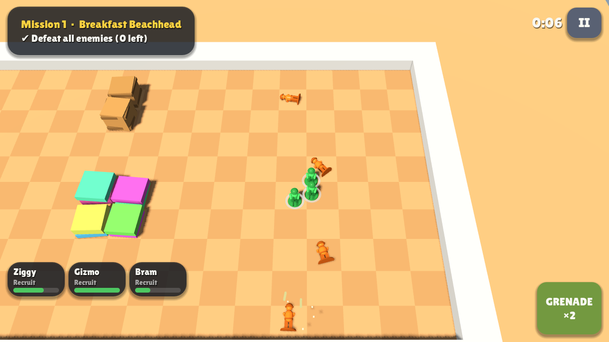
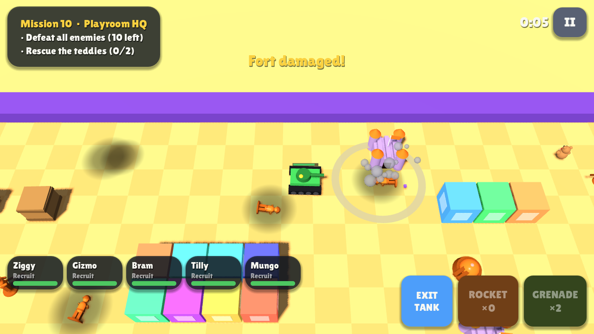

# Toy Squad

A top-down squad action game for Android. You lead a team of tiny plastic soldiers across giant household battlefields: breakfast tables, kitchen tiles, the garden lawn, the sandpit, the bath and more.

Built with **Godot 4.3** (GL Compatibility renderer, so it runs on older phones as well as new ones). Everything in it is original: the models are built from code, the music and sound effects are synthesised at start-up, and the only third-party asset is the [Lilita One](https://fonts.google.com/specimen/Lilita+One) font (SIL Open Font License, see `assets/OFL-LilitaOne.txt`).


| | |
|---|---|
|  |  |

## How to play

- **Tap the ground** and your squad moves there in formation.
- **Tap an enemy** to focus fire on it. Soldiers also fire at anything in range on their own.
- **Grenade / Rocket buttons:** tap the button, then tap the target. Forts only fall to explosives.
- **Tanks:** tap the tank to climb in, tap enemies to fire shells, then press EXIT TANK to hop out.
- **Drag** to look around, **pinch** to zoom.
- Rescue the teddy bears by walking next to them and leading them to the green zone.

## The 10 missions

| # | Mission | Setting | Objective | New idea |
|---|---------|---------|-----------|----------|
| 1 | Breakfast Beachhead | Kitchen table | Defeat all enemies | Moving and shooting |
| 2 | Tile Trouble | Kitchen floor | Destroy the fort | Grenades and forts |
| 3 | Lawn Offensive | Garden lawn | Defeat all enemies | Two forts, pickups |
| 4 | Sandbox Siege | Sandpit | Defeat all enemies | Snipers |
| 5 | Pond Rescue | Garden pond | Rescue 2 teddies | Rescue missions |
| 6 | Carpet Commandos | Bedroom | Defeat all enemies | Turrets and rockets |
| 7 | Bathtub Bay | Bathroom | Defeat all enemies | The toy tank |
| 8 | Dusty Attic | Attic | Rescue, then extract | Maze of boxes |
| 9 | Garage Gauntlet | Garage | Reach the green zone | Extraction run |
| 10 | Playroom HQ | Playroom | Defeat all and rescue | Final battle |

Levels are ASCII maps in `scripts/levels.gd`, so adding or editing one is a text change.

## Progression and monetization

- **Lives:** 5 lives, one used only when you fail or abandon a mission (wins are free). One life refills every 20 minutes. Missions 1 and 2 never cost a life.
- **Rewarded ads (optional):** +1 life, revive the squad once per mission, or double the mission coins. Capped at 10 per day.
- **Interstitial ads:** at most one every 3 missions, never in missions 1 and 2, removed by the No Ads purchase.
- **Gems:** refill all lives (10 gems) or revive (5 gems).
- **Purchases:** gem packs, a starter pack, and "No Ads + Unlimited Lives".
- **Coins** (earned by playing): extra grenades and rockets, and squad paint jobs (cosmetic only).
- **Daily supply drop:** a 7-day reward calendar.
- **Squad:** survivors are promoted after each win and shoot faster and straighter. Fallen soldiers go to the Toy Box of Honour and a new recruit takes their place.

In this build, ads and purchases are **simulated** (`scripts/ads.gd`, `SIMULATED := true`). To go live, add the Godot AdMob and Google Play Billing plugins and replace the three simulated calls in that file. Nothing else needs to change.

## Project layout

```
main.tscn / scripts/main.gd   screen flow: title, map, mission
scripts/game.gd               save data, lives, roster, rewards (autoload "Game")
scripts/sfx.gd                synthesised sound and music (autoload "Sfx")
scripts/ads.gd                ads and purchases facade (autoload "Ads")
scripts/levels.gd             the 10 missions as ASCII maps
scripts/mission/mission.gd    level building, simulation, input, camera, objectives, test bot
scripts/mission/unit.gd       soldiers, enemies, hostages, tanks
scripts/mission/models.gd     procedural toy models
scripts/mission/fx.gd         explosions and effects
scripts/mission/hud.gd        in-mission interface and results
scripts/ui/                   world map, shop, popups, UI helpers
tests/                        automated level tests
```

## Building

Requirements: Godot 4.3 with Android export templates, a JDK, and an Android SDK (build-tools for `apksigner`).

```bash
godot --headless --import
godot --headless res://tests/test_runner.tscn          # level tests (bot plays all 10)
export GODOT_ANDROID_KEYSTORE_RELEASE_PATH=/path/to/release.keystore
export GODOT_ANDROID_KEYSTORE_RELEASE_USER=toysquad
export GODOT_ANDROID_KEYSTORE_RELEASE_PASSWORD=...
godot --headless --export-release "Android" build/ToySquad.apk
```

The Play Store needs an `.aab` bundle, which needs Godot's Gradle build. The `Android build` GitHub Action (run it by hand from the Actions tab) builds both the APK and the AAB. Add the secrets `ANDROID_KEYSTORE_BASE64`, `ANDROID_KEYSTORE_ALIAS` and `ANDROID_KEYSTORE_PASSWORD` first so it signs with your upload key.

Screenshots for checking visuals: `godot --rendering-driver opengl3 -- --shot=mission:3 --secs=8 --out=/tmp/m3.png`.

The package name is `com.armygame.toysquad`. It can be changed in `export_presets.cfg` until the first Play Store upload, after which it is permanent.
